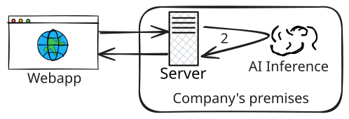
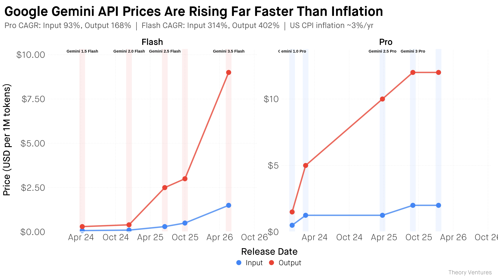
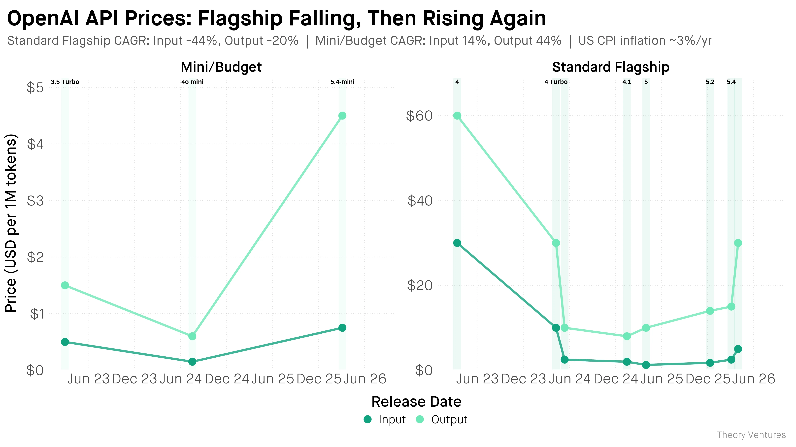
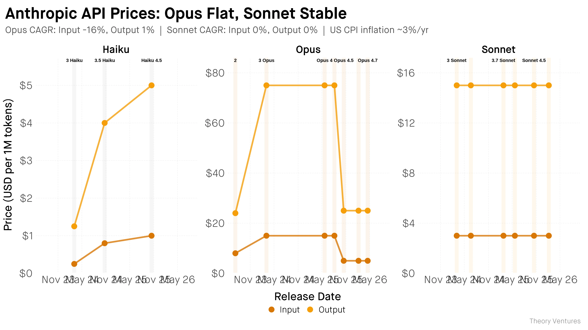

# AI inference through a third-party provider

 
 

- **Pricing**: pay-as-you-go. Some offer free plans.
- **Providers**: <logos-google-cloud /> , <logos-aws />, <logos-openai style="background:white; border-radius: 5px; padding: 2px;" />, <logos-microsoft-azure />, etc.

List of free LLM API resources provided by [cheahjs/free-llm-api-resources](https://github.com/cheahjs/free-llm-api-resources)

---

# On-premises AI inference

 
 

- **Tools** : Ollama, Jan AI, LM Studio, etc.

---
layout: center
---

# Challenges of server-side AI

- Privacy
- No offline support
- Cost: maintenance or subscription fees

---

# Unpredictable subscription costs

Phenomena: LLMflation, the LLM cost paradox

---

---

---
layout: center
hideInToc: true
---

---
layout: fact
---

# Is a server required?

---
layout: fact
---

# Is a server required? (Spoilers) No*

*In some use cases.
