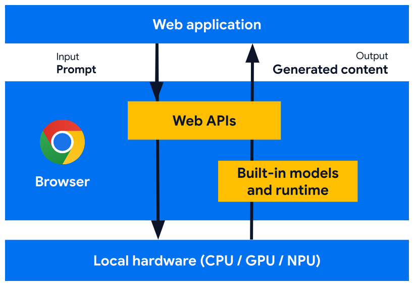
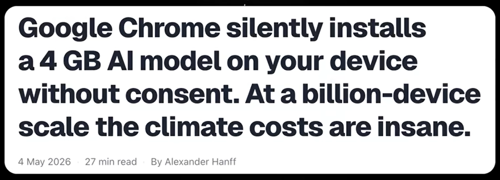
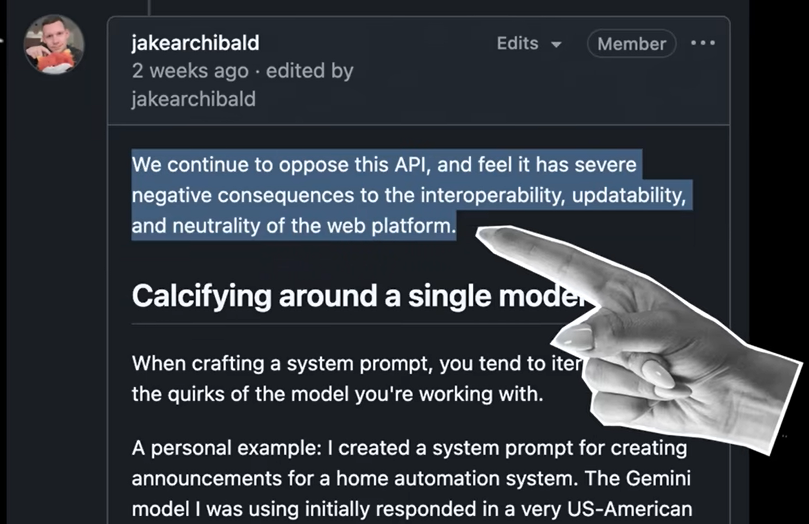
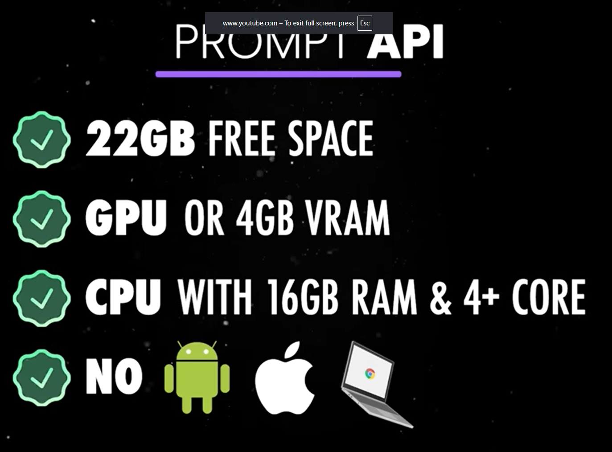

# Web AI

- **First-party** JavaScript APIs (no external library required)
- AI model **embedded** in, and **managed** by the browser
- Already **available** in Chrome and Opera



<style>
img {
  height: 30dvh;
  margin: auto;
}
</style>

---
layout: two-cols-header
---

# List of Web AI APIs

## Language models

::left::

- [Summarizer](https://developer.chrome.com/docs/ai/summarizer-api)
- [Language Detection](https://developer.chrome.com/docs/ai/language-detection)
- [Translator](https://developer.chrome.com/docs/ai/translator-api)
- [Prompt](https://developer.chrome.com/docs/ai/prompt-api)
- [Writer](https://developer.chrome.com/docs/ai/writer-api) <game-icons-vial />
- [Rewriter](https://developer.chrome.com/docs/ai/rewriter-api) <game-icons-vial />
- [Proofreader](https://developer.chrome.com/docs/ai/proofreader-api) <game-icons-vial />

::right::

## Decision models (System )

- [Decision](https://developer.chrome.com/docs/ai/decision-api) <game-icons-vial />

<style>

li {
  font-size: 2em;
}
</style>

---

# How to get started

- Opera: enable WebAI in the settings and manage model from the sidebar
- Chrome: [Install WebAI extension](https://chromewebstore.google.com/detail/lmjgpcigjcffnphimblhcoccjfefamcp?utm_source=item-share-cb)

---

# Example: Translator API

```js
// Check whether the Translator API is available in the browser
if (!("Translator" in window)) return;
// Configure the Translator API options
const options = {
  sourceLanguage: "fr",
  targetLanguage: "en",
};
// Check the Translator API's availability with the specified options
const availability = await Translator.availability(options);
if (availability === "unavailable") return;
// Create a Translator object with the desired options
const translator = await Translator.create(options);
// Ask the Translator object to translate text
const result = await translator.translate("Bonjour, monde !");
console.log(result);
// Expected output: "Hello, world!"
```

---
layout: two-cols-header
srcLeft: ./pages/webai-demo.md
---

# Web AI demo: multilingual chat

::left::

<iframe src="/web-ai/seamless-international-chat/"></iframe>

::right::

<iframe src="/web-ai/seamless-international-chat/"></iframe>

<style>
  iframe {
    border: none;
    border-radius: 8px;
    padding: 0;
    margin: 0;
    height: 450px;
    width: 350px;
  }  
</style>

---
layout: center
---

# Other demos

- [My demos](https://yostane.github.io/web-ai/)
- [Chrome demos](https://chrome.dev/web-ai-demos/)
- [Model information in chrome://on-device-internals/](chrome://on-device-internals/)

---

# Status of the project

- Still in development
- Not a W3C standard (yet)

---

# The downside of local AI

Source: [Awesome](https://www.youtube.com/watch?v=seKv8ZyTiOU)



---
layout: full
---



<style>
  img{
    height: 500px;
  }
</style>

---
layout: center
---



<style>
  img{
    height: 500px;
  }
</style>

---

<Youtube id="seKv8ZyTiOU" style="width:100%;height:100%;" />
