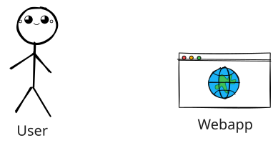
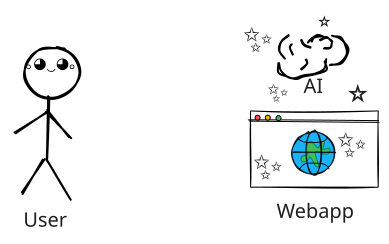
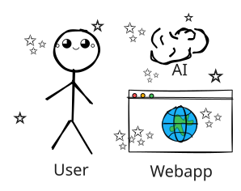
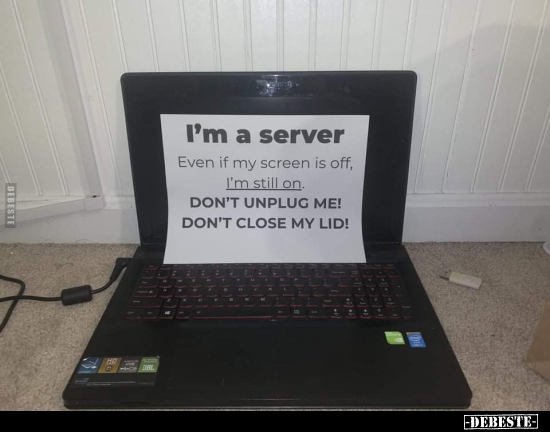
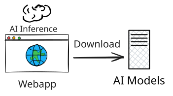
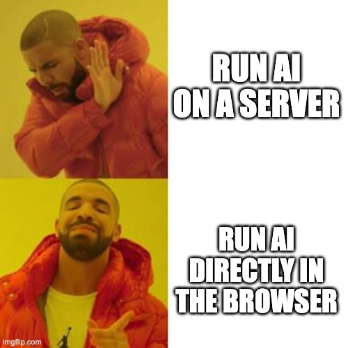

  

    
    
    
  

  

    

      <twemoji-writing-hand class="text-3xl"/>
      <ul style="list-style: none;" class="mt-4">
        <li>Summarization</li>
        <li>Translation</li>
      </ul>
    

    

      <twemoji-framed-picture class="text-3xl"/>
      <ul style="list-style: none;" class="mt-4">
        <li>Background removal</li>
        <li>Face detection</li>
      </ul>
    

    

      <twemoji-studio-microphone class="text-3xl"/>
      <ul style="list-style: none;" class="mt-4">
        <li>Text-to-speech</li>
        <li>Speech recognition</li>
      </ul>
    

  

---
layout: center
---

---
layout: cover
---

# The future of AI (is) in the browser

 / 📅 November 11

---
src: ./pages/bio.md
---

---
layout: two-cols
---

# Agenda <twemoji-spiral-calendar />

<Toc minDepth="1" maxDepth="1" />

::right::

---
src: ./pages/serverai.md
---

---
hideInToc: false
---

# AI inference in the browser

- The Browser **downloads** the AI model
- Inference is done **locally** in the browser

---
src: ./pages/transformersjs.md
---

---
src: ./pages/opencvjs.md
---

---
src: ./pages/webai.md
---

---
src: ./pages/conclusion.md
---

---
layout: center
---

---
layout: end
---

# Thank you 😊

Any questions?

<QRCode
    :width="270"
    :height="270"
    type="svg"
    data="https://yostane.github.io/web-ai/slides-fblille2026"
    :imageOptions="{ margin: 5 }"
    :dotsOptions="{ type: 'extra-rounded', color: 'white' }"
/>

Source code: [yostane/web-ai](https://github.com/yostane/web-ai/tree/main/samples) <logos-github-icon style="background:white; border-radius: 5px; padding:1px" />
 
Credits: Tenor, Chrome for Developers, <PoweredBySlidev mt-5 />
